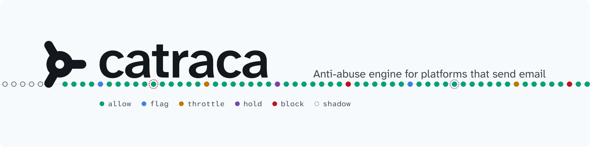
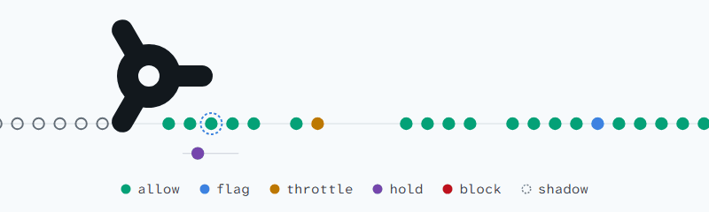

<p align="center">
  <picture>
    <source media="(prefers-color-scheme: dark)" srcset="docs/brand/readme-banner-dark.svg">
    
  </picture>
</p>

<p align="center">
  <a href="https://github.com/guilhermebsantiago/catraca/actions/workflows/ci.yml"></a>
  <a href="https://scorecard.dev/viewer/?uri=github.com/guilhermebsantiago/catraca"></a>
  <a href="LICENSE"></a>
  <a href="go.mod"></a>
  <a href="https://catraca.guilhermebs.com.br"></a>
</p>

**Catraca is a self-hosted anti-abuse engine for platforms that send email.**
Your platform asks it before each send and reports delivery feedback and
account activity. Catraca answers in a millisecond or two with an action
(allow, flag, throttle, hold or block) and the rules behind it, so a bought
list or a leaked API key is stopped before it spends the reputation every
other sender depends on.

[Watch the 45-second demo](https://catraca.guilhermebs.com.br/#video-title) ·
[Website](https://catraca.guilhermebs.com.br) ·
[Design](docs/design.md) ·
[HTTP API](docs/api.md)

<picture>
  <source media="(prefers-color-scheme: dark)" srcset="docs/media/lane-dark.gif">
  
</picture>

## Why

A platform that sends email for its customers shares one reputation among
them: its IP addresses, its domains, its account with the email provider.
When one customer mails a bought list, or a leaked key starts sending spam,
bounces and complaints rise for everyone, and providers pause sending when
those rates climb. One abuser can stop the password resets of every good
customer.

Catraca sits in the send path and is built on a few principles:

- **Default to trust.** Good senders never notice it. Friction goes where it
  costs abusers the most.
- **A false positive is a bug.** Rules start in shadow mode, recording what
  they would do. Reviewers label matches, every reversal is a label, and a
  rule only enforces once its measured precision clears a gate (a Wilson 95%
  lower bound over enough labels).
- **Fail safe.** Each rule declares what happens when it cannot be evaluated.
  A slow, broken or overloaded store degrades detection; it never blocks
  everyone, and decisions it cannot serve in time are shed at once instead
  of queueing behind it.
- **Traceable.** Every decision carries its rules and reasons and lands in an
  audit log, with Prometheus metrics and signed webhooks for effects such as
  revoking a key.

## What it does

- **Rules in CEL**, kept in git and reviewed like code, with fixtures,
  linting, a version hash in every decision and hot reload.
- **Signals** over sliding windows, in Redis (one Lua call per decision;
  standalone, Sentinel or Cluster) or memory: per account, API key, IP and
  sender domain.
  Velocity, recipient spread, bounce and complaint rates, new and recent IPs,
  keys used from many places, leaked keys. [All signals](docs/signals.md).
- **A starter ruleset** for email senders: new-account bursts, complaint and
  hard-bounce rates, leaked keys, keys used from many IPs, account takeover
  volume spikes, shortener links from new accounts, signup farms, recipient
  spraying. [rules/default.yaml](rules/default.yaml)
- **Backtesting**: `catraca replay` runs a ruleset over labeled events and
  reports precision and recall per rule before anything ships.
- **Feedback** from Amazon SES (through SNS, signature verified) and useSend,
  or a generic signed endpoint.
- **Leaked keys** through GitHub's secret scanning partner program: the
  endpoint verifies GitHub's signature and stores each report before it
  answers, then resolves the key with your platform, blocks it and fires
  your `revoke_key` hook, retrying through outages and restarts.
- **Audit log** in SQLite or Postgres, a review queue, labels, and
  `catraca report` / `catraca rules gate` to promote and retire rules.

## Quick start

With Docker, Redis counters and a Postgres audit log:

```sh
git clone https://github.com/guilhermebsantiago/catraca && cd catraca/deploy
export CATRACA_API_TOKEN=$(openssl rand -hex 32) CATRACA_FEEDBACK_SECRET=$(openssl rand -hex 32)
docker compose up --build
```

From source (Go 1.26+), with in-memory counters and SQLite:

```sh
go build -o catraca ./cmd/catraca
cp catraca.example.yaml catraca.yaml
export CATRACA_API_TOKEN=$(openssl rand -hex 32) CATRACA_HOOK_SECRET=$(openssl rand -hex 32) CATRACA_FEEDBACK_SECRET=$(openssl rand -hex 32)
./catraca config check && ./catraca serve
```

Ask before a send:

```sh
curl -s localhost:8080/v1/decide -H "Authorization: Bearer $CATRACA_API_TOKEN" \
  -d '{"type": "send", "account_id": "acct_tidal", "api_key_id": "key_9c2e", "ip": "192.0.2.200",
       "from": "alerts@tidal.example", "to": ["carla.34@box.example"], "subject": "Urgent: verify your account"}'
```

This key had been reported leaked, so the answer, recorded from a real run,
is a block that also fires the `revoke_key` hook:

```json
{"decision": {
  "id": "01M50Y33JMPZ4MYNAJMWSCZMV0",
  "time": "2026-10-15T23:24:23.5084785Z",
  "action": "block",
  "matches": [{"rule_id": "leaked-key-send", "action": "block", "mode": "enforce", "effects": ["revoke_key"],
               "reason": "This API key was found in public and must be rotated before it can send again"}],
  "ruleset_version": "3ed1ef48775c",
  "latency_us": 109
}}
```

The platform acts on `action`. Out of the box every starter rule runs in
shadow mode except `leaked-key-send`, so Catraca records what it would do and
blocks only keys reported leaked. Clients: a typed
[TypeScript client](examples/client-ts) that fails open and a
[Hono example](examples/hono) that maps each action to an HTTP answer.

## Performance

| | p50 | p99 |
|---|---|---|
| Engine decision, default ruleset (Go benchmark) | 3.5 µs | |
| `POST /v1/decide`, in-memory counters, 1,000 req/s | 0.24 ms | 0.56 ms |
| `POST /v1/decide`, Redis 7.4 counters, 1,000 req/s | 2.21 ms | 2.97 ms |

Ryzen 5 7600X, open-loop load from [bench/load](bench/load) on the same
machine, SQLite audit log; the Redis numbers come from the Windows build of
Redis, so read them as indicative. One Redis core handles about 2,000
decisions a second. Method, before-and-after numbers for the Redis store and
caveats: [docs/benchmark.md](docs/benchmark.md).

## Docs

- [Design](docs/design.md): principles, packages, signals, rules, engine
- [HTTP API](docs/api.md) · [Configuration](docs/config.md) · [Command line](docs/cli.md)
- [Signals](docs/signals.md) · [Writing rules](docs/rules.md)
- [Audit log and the precision gate](docs/audit.md) · [Hooks](docs/hooks.md)
- [Feedback: SES, useSend](docs/feedback.md) · [GitHub secret scanning](docs/secret-scanning.md)
- [Objectives and alerts](docs/slo.md) · [Tracing](docs/tracing.md)
- [Benchmarks](docs/benchmark.md) · [Brand](docs/brand.md)

## Examples

- [TypeScript client](examples/client-ts): typed, dependency-free, fails open
- [Hono email API](examples/hono) that asks Catraca before each send
- [Synthetic replay dataset](examples/replay) and the starter ruleset's
  backtest on it
- [Demo scenario](examples/demo) against a real server, recorded for the
  [launch video](docs/media/catraca.mp4) ([how it is made](media))

## Status

Early: everything above works and is tested (unit, contract, end-to-end, and
CI against real Redis, Postgres and Docker), but the API and configuration
may still change before a first tagged release.

Releases will be cut from `v*` tags: binaries for Linux, macOS and Windows
(amd64 and arm64) with checksums, SBOMs and build provenance, and a signed
multi-arch image at `ghcr.io/guilhermebsantiago/catraca`.
[SECURITY.md](SECURITY.md#verifying-a-release) shows how to verify them.

## Development

```sh
go test ./...
```

Postgres tests run when `CATRACA_TEST_POSTGRES_URL` is set, and the store's
contract suite, the signal tests and their benchmarks also run against a
real Redis when `CATRACA_TEST_REDIS_URL` is set (for example
`redis://localhost:6379/0`) and against a Redis Cluster when
`CATRACA_TEST_REDIS_CLUSTER` lists some of its nodes
(`localhost:7001,localhost:7002`). CI runs Postgres and Redis, and also
govulncheck, CodeQL, the OpenSSF Scorecard and a dry run of the release. See
[CONTRIBUTING.md](CONTRIBUTING.md), and report vulnerabilities as described
in [SECURITY.md](SECURITY.md).

## License

[Apache-2.0](LICENSE). Made by [Guilherme Santiago](https://guilhermebs.com.br).
