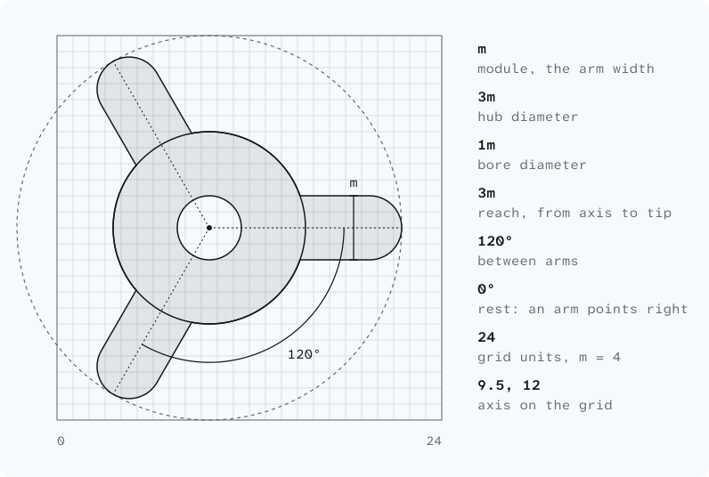
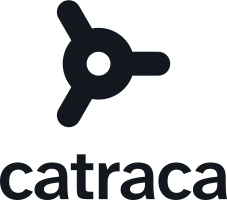
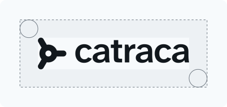
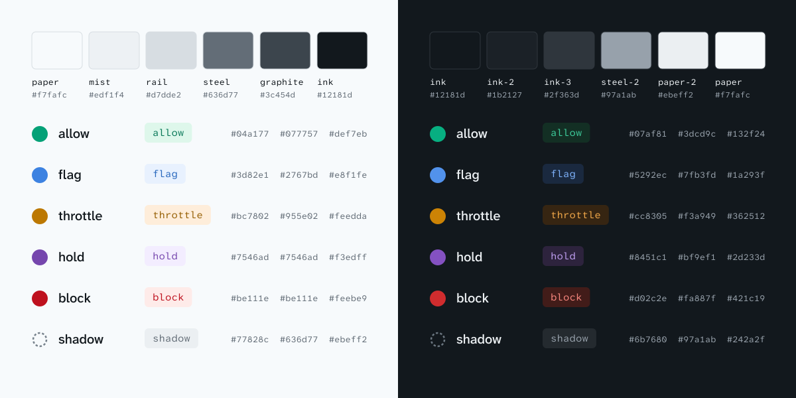

<picture>
  <source media="(prefers-color-scheme: dark)" srcset="brand/readme-banner-dark.svg">
  
</picture>

# Catraca identity

*Catraca* is Portuguese for turnstile. It lets people through one at a time
and stops the ones who shouldn't pass. In Portuguese the word also names a
ratchet, the wheel that turns one way, one notch at a time. Both meanings
describe the engine: it decides every event as it passes, it trusts by
default, and it only ever moves forward one step per decision.

The identity is built from two things: the **rotor** of a tripod turnstile
seen from above, and the **lane**, where events arrive as open rings, pass the
rotor one at a time and leave as decisions, filled with the color of their
action. Everything else is quiet: steel neutrals, one typeface family, and
color that appears only when it means a decision.

## Mark



Everything is a multiple of one module, **m**, the width of an arm.

| part | construction |
|---|---|
| Grid | 24 × 24 units, m = 4 |
| Hub | circle, diameter 3m |
| Bore | circle, diameter 1m; the ring left around it is 1m thick |
| Arms | 1m wide with round ends, reaching 3m from the axis to the tip |
| Angles | 0°, 120°, 240°: at rest one arm points right, the direction of travel |
| Axis | (9.5, 12), which centers the 19 × 21.32 bounding box in the square |

The mark is one filled path (the bore is a counter, not a white shape), so it
works in a single color on any background. It reads at 16 px: the favicon
draws it 10% larger on the same grid (m = 4.4) to fill the tab.

## Wordmark and lockups

| Horizontal | Stacked |
|---|---|
|  |  |

The wordmark is **catraca**, lower case: it is the word developers type
(`catraca serve`, `catraca rules check`), and its round c and a echo the hub.
It is Atkinson Hyperlegible Next SemiBold (600), tracked −20/1000 em and
outlined, so always use the files instead of setting it in type. In running
text the name is a proper noun: Catraca.

- **Horizontal:** the hub's diameter equals the x-height, the axis sits on the
  middle of the x-height, and the gap from the tip of the right arm to the c is
  one hub radius (1.5m).
- **Stacked:** the mark at twice the word's module, its bounding box centered
  over the word, 3m above the x-height.

**Clear space** is one hub (3m) on every side of a lockup. **Minimum size:**
the mark 16 px, the horizontal lockup 20 px tall (95 px wide), the stacked
lockup 48 px tall.



## Color



The neutrals are a cool steel gray, the color of the turnstile. **Color is
reserved for decisions:** the five actions and shadow mode each have, per
theme, a *mark* color (fills, chart marks, lines; at least 3:1 on the
background), a *text* color (at least 4.5:1 on the background and on its
tint) and a *tint* for badges. Color never carries meaning alone: the action
is always named next to it, in words or in the mono.

The five marks were chosen together in OKLCH so that every pair stays apart
under protanopia and deuteranopia (Machado 2009, severity 1): worst pair
ΔE<sub>OK</sub> 11.0 in light (flag and hold), 11.1 in dark (throttle and
block), and at least 16.5 for normal vision. In charts, keep them in severity
order: allow, flag, throttle, hold, block.

**Neutrals**

| token | hex | on paper | on ink | use |
|---|---|---|---|---|
| ink | `#12181D` | 17.06 | | text, the mark on light; dark background |
| ink-2 | `#1B2127` | | 1.10 | raised surfaces on dark |
| ink-3 | `#2F363D` | | 1.46 | lines on dark |
| graphite | `#3C454D` | 9.32 | | secondary text on light |
| steel | `#636D77` | 5.03 | | muted text on light (4.64 on mist) |
| steel-2 | `#97A1AB` | | 6.82 | muted text on dark (6.19 on ink-2) |
| rail | `#D7DDE2` | 1.31 | | lines on light |
| mist | `#EDF1F4` | 1.08 | | raised surfaces on light |
| paper-2 | `#EBEFF2` | | 15.47 | text on dark |
| paper | `#F7FAFC` | | 17.06 | light background; the mark on dark |

**Actions, light theme** (on paper `#F7FAFC`)

| action | mark | on bg | text | on bg / on tint | tint |
|---|---|---|---|---|---|
| allow | `#04A177` | 3.15 | `#077757` | 5.29 / 4.92 | `#DEF7EB` |
| flag | `#3D82E1` | 3.66 | `#2767BD` | 5.33 / 4.90 | `#E8F1FE` |
| throttle | `#BC7802` | 3.44 | `#955E02` | 5.16 / 4.73 | `#FEEDDA` |
| hold | `#7546AD` | 6.19 | `#7546AD` | 6.19 / 5.68 | `#F3EDFF` |
| block | `#BE111E` | 6.09 | `#BE111E` | 6.09 / 5.56 | `#FEEBE9` |
| shadow | `#77828C` | 3.74 | `#636D77` | 5.03 / 4.56 | `#EBEFF2` |

**Actions, dark theme** (on ink `#12181D`)

| action | mark | on bg | text | on bg / on tint | tint |
|---|---|---|---|---|---|
| allow | `#07AF81` | 6.35 | `#3DCD9C` | 8.87 / 7.13 | `#132F24` |
| flag | `#5292EC` | 5.69 | `#7FB3FD` | 8.32 / 6.82 | `#1A293F` |
| throttle | `#CC8305` | 5.81 | `#F3A949` | 9.01 / 7.40 | `#362512` |
| hold | `#8451C1` | 3.35 | `#BF9EF1` | 7.99 / 6.61 | `#2D233D` |
| block | `#D02C2E` | 3.48 | `#FA887F` | 7.57 / 6.30 | `#421C19` |
| shadow | `#6B7680` | 3.86 | `#97A1AB` | 6.82 / 5.53 | `#242A2F` |

**Terminal.** Use the text colors as truecolor. Fallbacks, light / dark
terminal: xterm-256 allow 29 / 43, flag 25 / 111, throttle 94 / 215, hold
61 / 147, block 124 / 210, shadow 242 / 247; with 16 colors, allow green,
flag blue, throttle yellow, hold magenta, block red, and shadow as the action's
color dimmed (SGR 2) next to the word `shadow`.

`brand/tokens.css` has all of this as custom properties (`--ct-allow`,
`--ct-allow-text`, `--ct-allow-tint`, ..., switching with
`prefers-color-scheme` or `data-theme`); `brand/tokens.json` has both themes,
the terminal mapping, type and motion.

## Typography

[Atkinson Hyperlegible Next](https://fonts.google.com/specimen/Atkinson+Hyperlegible+Next)
for words and [Atkinson Hyperlegible Mono](https://fonts.google.com/specimen/Atkinson+Hyperlegible+Mono)
for code, terminals, ids, keys, domains and numbers in tables. Both are by the
Braille Institute with Applied Design Works, variable from 200 to 800, under
the SIL Open Font License 1.1.

Atkinson Hyperlegible was drawn so that letters that are easy to confuse look
different: I, l and 1; O and 0; rn and m. Telling lookalikes apart is
Catraca's job too: a leaked key's l from its I, `paypa1.com` from
`paypal.com`. One family keeps the page calm; the mono is the voice of the
engine.

- Scale (px): 12, 14, 16, 18, 21, 24, 36, 48, 72.
- Body 16/1.5 regular. Headings 600, tracking −0.01em, leading 1.1.
  Code 14–15 px mono, leading 1.6.
- Sentence case everywhere, no capitalized labels. Rule ids, actions and
  signals are set in the mono exactly as they appear in the API
  (`new-account-burst`, `throttle`, `account.sends_1m`).

```html
<link href="https://fonts.googleapis.com/css2?family=Atkinson+Hyperlegible+Mono:wght@400;600&family=Atkinson+Hyperlegible+Next:wght@400;500;600&display=swap" rel="stylesheet">
```

## Motion

Principles for the video and the site. Tokens: `--ct-turn`,
`--ct-ease-turn`, `--ct-duration-*` in `tokens.css`.

**The rotor is a ratchet.** It turns one way only, in the direction of
travel (counterclockwise when the lane runs under the hub, as in every asset), a
third of a turn per passage. 120° brings it back to the same pose, so at rest
the mark is always the mark. A turn takes 320 ms on
`cubic-bezier(0.6, 0, 0.2, 1.2)`: a push, then a click about 3° past the
detent and back. It never spins on its own and is never a loading indicator;
when nothing passes, it is still.

**The lane is steady.** Events move left to right at a constant speed, one
place every 480 ms, evenly spaced: one at a time. An event arrives as an open
ring and takes its action's color at the instant the rotor clicks (120 ms).
Most traffic is allowed and allow is uneventful: no flash, no sound, no pause.
Motion shows a decision; it never dramatizes one.

| action | rotor | event |
|---|---|---|
| allow | turns | passes, fills green |
| flag | turns | passes, fills blue; a note for later, nothing slows |
| throttle | waits | waits at the arm while a thin ring counts down `retry_after` (linear), then passes, amber; the queue behind it waits |
| hold | turns | is carried through, then steps out of the lane into a bay beside it (320 ms, ease-out), fills violet and stays for a person |
| block | holds | meets the arm, which gives 2° and clicks back (120 ms); fills red and leaves the lane downward (200 ms fade, ease-in). No shake, no flash |

**Shadow mode** never changes what happens: the event follows the enforced
action, usually allow. What the shadow rule would have done is a dashed ring
in that action's color around the event, appearing as it is decided and
traveling with it. Dashed means "not enforced": the ring never fills, never
moves the event, never stops the rotor. Promotion to enforce, after the gate,
is the one moment a dashed ring closes into a solid one (200 ms).

**Failing safe.** When the store is down and rules fail open, the rotor keeps
turning: traffic flows, and degraded decisions carry a small steel dot.

**Reduced motion.** No rotation and no travel: states change by a 200 ms
crossfade, and a throttle countdown becomes a number.

## Do and don't

Do:

- Use the mark in one color: ink on light, paper on dark.
- Keep it at rest in static use: one arm pointing right.
- Use color only for decisions, always with the action's name.
- Set identifiers, keys, domains and numbers in the mono.

Don't:

- Rotate or mirror the mark. Mirroring reverses the direction of travel.
- Enclose the mark in a circle or ring: three arms in a ring is a car badge.
- Add gradients, shadows, outlines or a second color to the mark.
- Use the action colors as decoration, or green as a brand color.
- Spin the rotor continuously, or use it as a loader.
- Retype the wordmark, capitalize it, or set it in another font.

## Files

All in [`brand/`](brand):

| file | what it is |
|---|---|
| `logo/mark-on-light.svg`, `logo/mark-on-dark.svg` | the mark on the 24-unit grid |
| `logo/horizontal-on-light.svg`, `logo/horizontal-on-dark.svg` | horizontal lockup |
| `logo/stacked-on-light.svg`, `logo/stacked-on-dark.svg` | stacked lockup |
| `logo/wordmark-on-light.svg`, `logo/wordmark-on-dark.svg` | wordmark alone |
| `favicon.svg` | the mark, ink or paper following the browser's color scheme |
| `icon.svg`, `icon-512.png`, `icon-192.png` | app icon: paper rotor on an ink tile |
| `social-preview.svg`, `social-preview.png` | GitHub social preview, 1280 × 640, content inside a 40 px margin |
| `readme-banner-light.svg`, `readme-banner-dark.svg` | README banner, 1600 × 400 |
| `construction.svg`, `clear-space.svg`, `palette.svg` | the figures on this page |
| `tokens.css`, `tokens.json` | color, type and motion tokens |
| `build/` | the scripts that generate all of the above |

Every asset is generated from the same geometry and palette by
`brand/build/build.py`, with text outlined from the fonts; `render.mjs`
optimizes the SVGs and renders the PNGs. The banner in a README, switching
with GitHub's theme:

```html
<picture>
  <source media="(prefers-color-scheme: dark)" srcset="docs/brand/readme-banner-dark.svg">
  
</picture>
```

The social preview is uploaded by hand in the repository's settings, under
Social preview.
